2024 - 2026  
<a href="https://devcharlotte.github.io/my-zip/">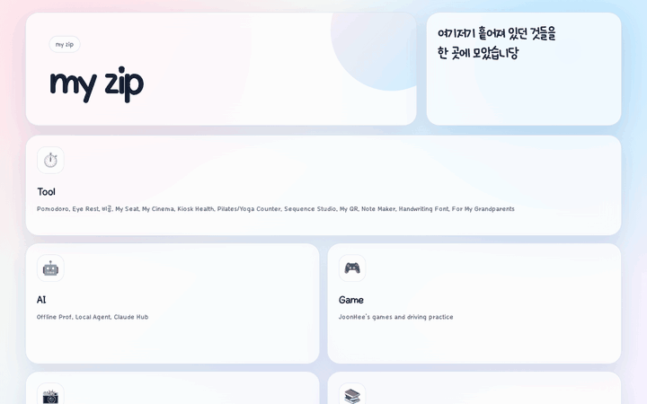</a>
<a href="https://devcharlotte.github.io/my-zip/ai/offline-prof/">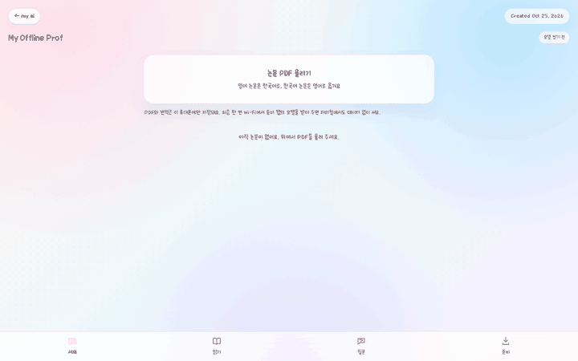</a>
<a href="https://devcharlotte.github.io/my-zip/ai/local-agent/">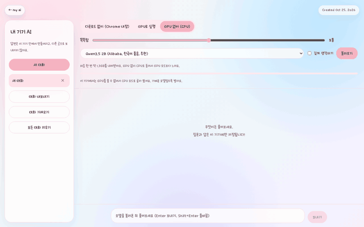</a>
<a href="https://devcharlotte.github.io/my-zip/ai/claude-hub/">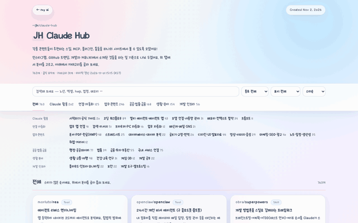</a>
<a href="https://devcharlotte.github.io/my-zip/tool/notemaker/">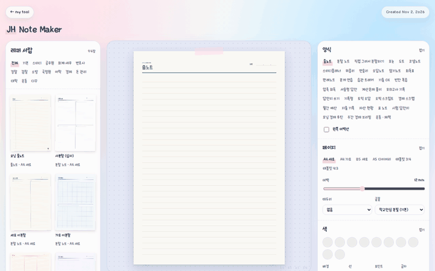</a>
<a href="https://devcharlotte.github.io/my-zip/tool/for-my-grandparents/">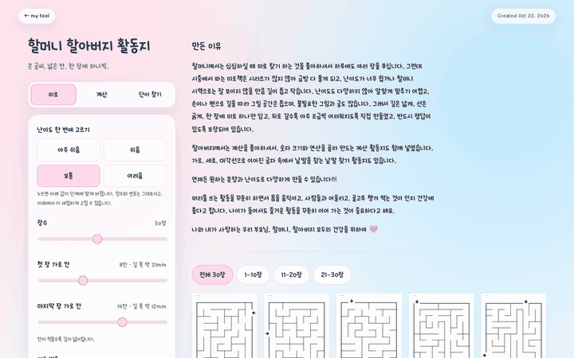</a>
<a href="https://devcharlotte.github.io/my-zip/tool/my-handwriting-font/">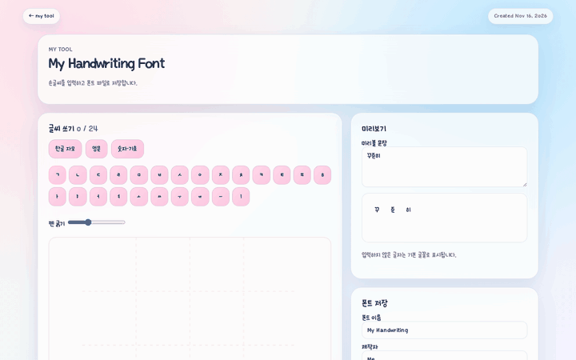</a>
<a href="https://devcharlotte.github.io/my-zip/tool/where-we-are/">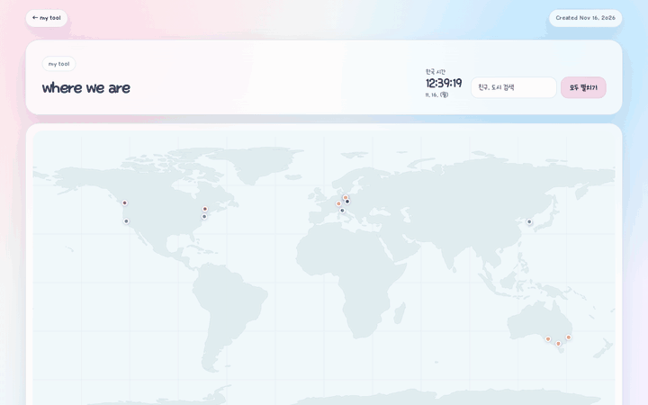</a>

<a href="https://devcharlotte.github.io/my-zip/tool/my-qr/">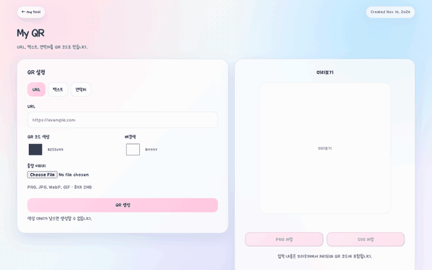</a>
<a href="https://devcharlotte.github.io/my-zip/game/games/number-baseball/">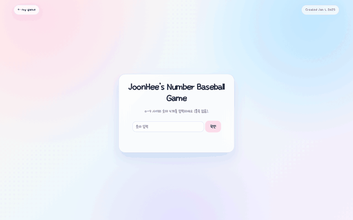</a>
<a href="https://devcharlotte.github.io/my-zip/game/games/2048/">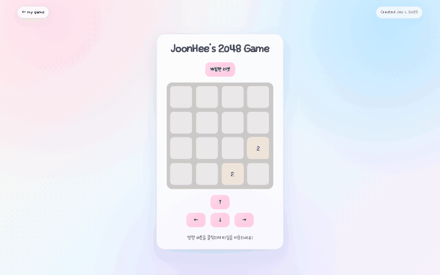</a>
<a href="https://devcharlotte.github.io/my-zip/game/games/bounce-ball/">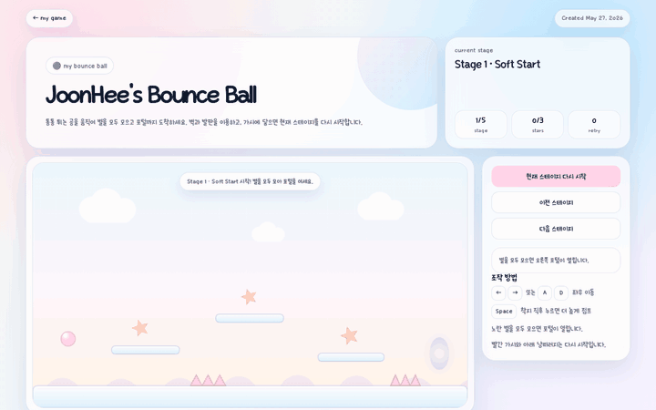</a>
<a href="https://devcharlotte.github.io/my-zip/game/games/bowling/">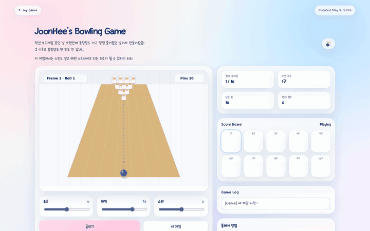</a>
<a href="https://devcharlotte.github.io/my-zip/game/games/davinci-code/">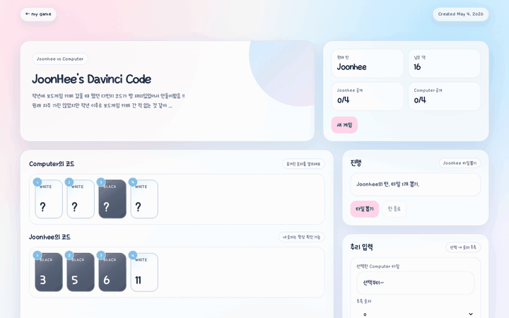</a>

<a href="https://devcharlotte.github.io/my-zip/game/games/my-cipher-lab/">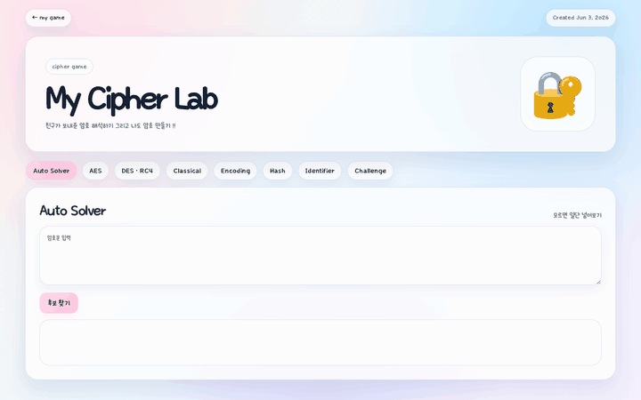</a>
<a href="https://devcharlotte.github.io/my-zip/game/games/my-driving-skills/">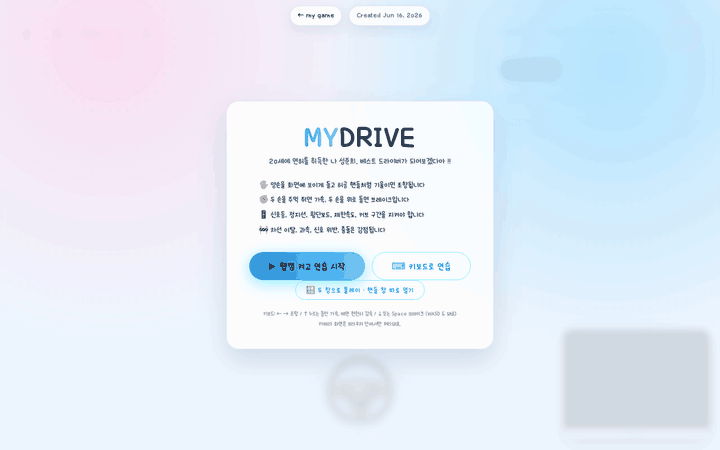</a>
<a href="https://devcharlotte.github.io/my-zip/photo/life-4-cuts/">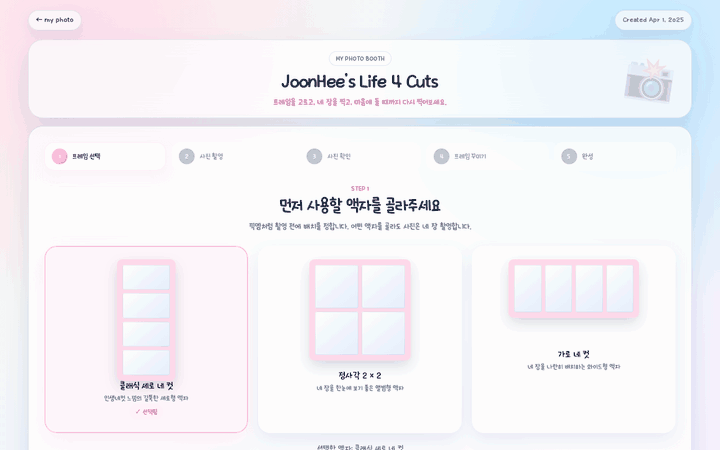</a>
<a href="https://devcharlotte.github.io/my-zip/tool/pomodoro/">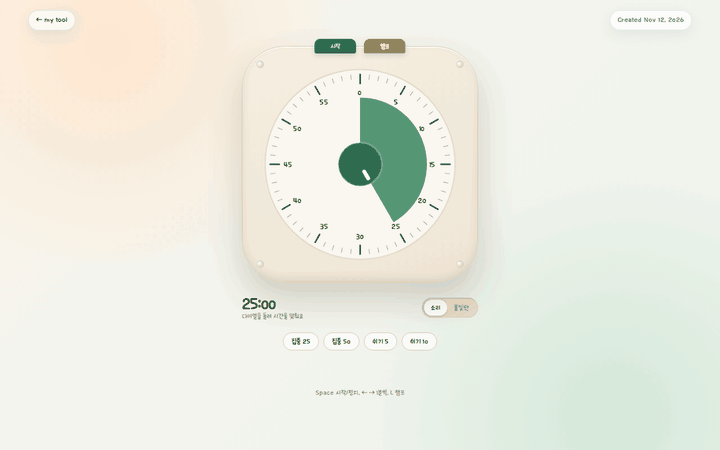</a>
<a href="https://devcharlotte.github.io/my-zip/tool/my-seat/">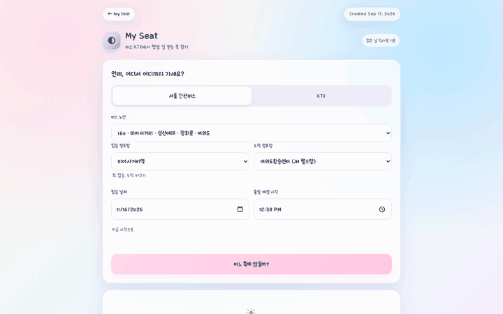</a>

<a href="https://devcharlotte.github.io/my-zip/tool/pilates-yoga-counter/">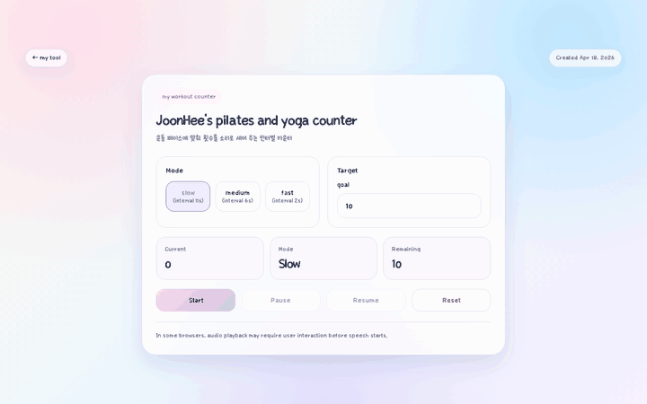</a>
<a href="https://devcharlotte.github.io/my-zip/tool/sequence-studio/">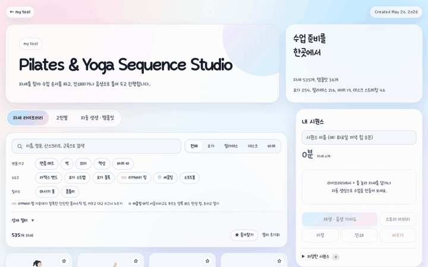</a>
<a href="https://devcharlotte.github.io/my-zip/tool/eye-rest/">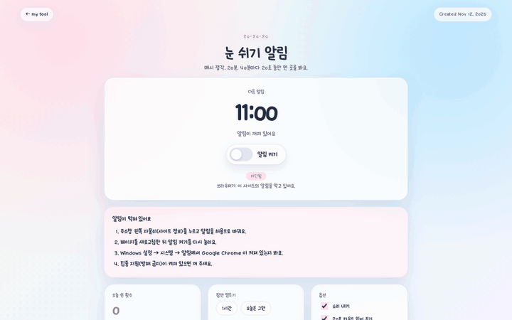</a>
<a href="https://devcharlotte.github.io/my-zip/tool/bigong/">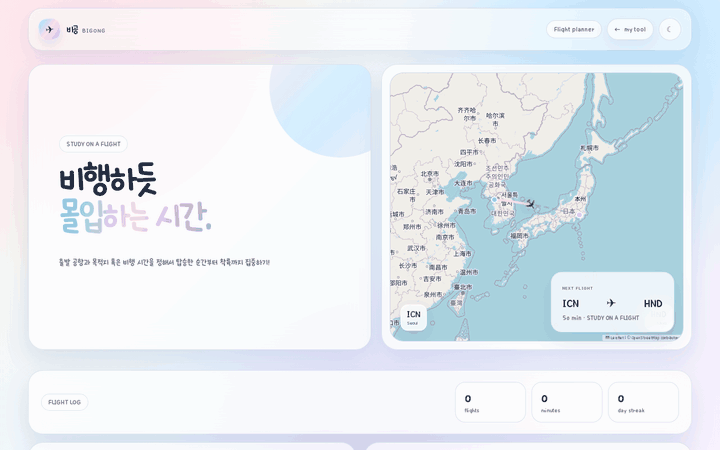</a>

<a href="https://devcharlotte.github.io/my-zip/culture/reading-trend-digging/">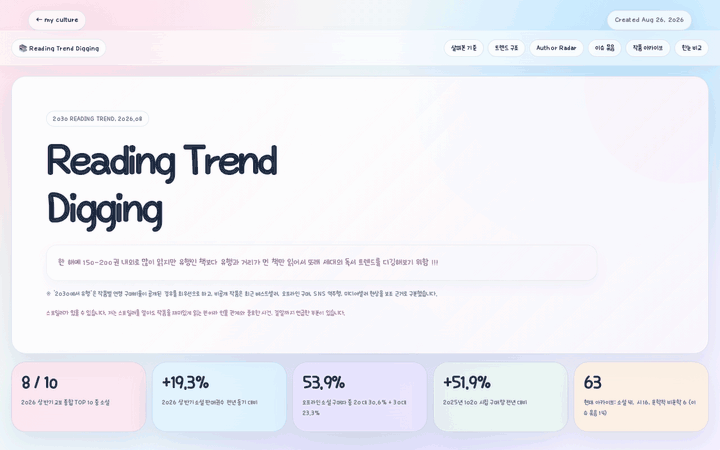</a>
<a href="https://devcharlotte.github.io/my-zip/culture/frieze-week-2026/">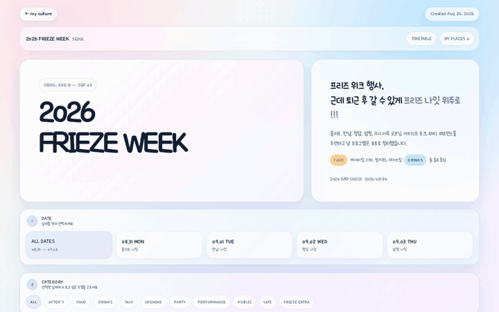</a>
